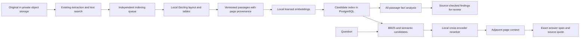

# Structured document intelligence

The candidate pipeline addresses a limitation in the original implementation:
word-hash vectors, a lexical-overlap gate and flattened chunks cannot provide
reliable semantic retrieval. Joining selected source lines also does not produce
a comprehensive document explanation.

The homelab profile enables **preview**, with the existing analysis available for
comparison. Preview findings never overwrite production metadata, summaries,
tags or reminders. It is not an assertion that document understanding is solved.

## Processing and provenance

Every index binds an extraction ID, parser identity, embedding model revision,
dimensions and pipeline version. Publication rechecks the current extraction and
original-file hash. Model mismatches, partial page conversion and ambiguous page
provenance fail explicitly. Failed indexing preserves original access and text
search. Redelivery does not replace a completed index.

Paragraphs continuing across pages are split using Docling character spans. Each
piece retains its actual page, and retrieval can include adjacent pages as separate
citations. Overlapping or incomplete character provenance is rejected. Ambiguous
multi-page table provenance and headers exceeding the current passage budget
remain explicit preview limitations.

Retrieval streams the complete eligible owner corpus, maintaining bounded
candidate heaps for BM25 and cosine similarity. Reciprocal rank fusion feeds the
reranker; there is no lexical-overlap requirement or first-5,000-passage cutoff.
Neighbor expansion and the final answer both recheck ownership and source
currency. Archived documents are excluded. A missing or failed current index
prevents a library answer that might misleadingly imply full coverage.

The PostgreSQL scan is appropriate for an initial personal vault. Its work grows
linearly with passage count; a large installation should replace the candidate
scan with indexed BM25 and an ANN index, retaining the same authorization and
version checks. A vector database alone does not supply those checks.

## Findings and answers

All passages enter local model batches packed by serialized input size. Small table
rows share a batch rather than wasting a model call per fixed handful of rows.
Findings can describe identities,
dates, amounts, obligations, conditions, exclusions and other terms without a
document-specific list of five fields. Values must occur in the supplied quote,
and the quote must occur in the referenced passage. Invalid findings are rejected
and counted. Page and passage coverage are reported separately from fact accuracy.

Each completed analysis batch is committed independently and becomes visible in
the preview, including while later batches are running or have failed. Retries
resume verified checkpoints only when the source batch plan, model digest and
prompt version match. A changed source or model starts fresh; a superseded run
cannot overwrite a newer run. Database transactions stay short and are not held
open during model inference. The background consumer allows up to 900 seconds
per CPU model request independently of the interactive question timeout.

The owner-only `POST /questions/intelligence/{document_id}/retry` endpoint queues
failed indexing or resumes fact analysis for an existing ready index. The document
preview exposes the same action and retains already verified source findings.

The model selects source sentence IDs rather than copying or rewriting values.
The application resolves those IDs to the original text, preserving number words,
units and qualifications. Selected source units become the answer or finding;
unsupported IDs are rejected. This prevents a copied quote from silently changing
"twenty" into "20" or normalizing a date into an unsupported interpretation.

Exact quotation proves provenance, **not entailment or completeness**. A model can
still choose the wrong fact, omit an exception or supply a misleading heading.
These findings therefore remain marked `needs_review`. They are presented as
individual facts with expandable evidence, not concatenated into a summary.
The preview answer selector also requires an exact source span and quote; it
refuses unsupported generation. It cannot yet calculate totals, synthesize a
multi-document answer or reliably resolve contradictions. No truth-confidence
percentage is displayed for this path.

A future readable overview must be generated from reconciled findings, preserve
conditions and conflicts, and pass a separate claim-support evaluation. Retrieval
quality is not an acceptable substitute for that evaluation.

## Private services and deployment

The manifests pin Docling Serve and TEI container digests and embedding/reranking
model revisions. Docling remote integrations and external plugins are disabled;
clients use private endpoints, disable HTTP proxy inheritance and reject redirects.
Provider error bodies are excluded from application exceptions. Original filenames
are replaced with neutral names in parser requests. No hosted inference fallback
exists in the candidate path.

Services are `papervault-parser:5001`, `papervault-embeddings:80`,
`papervault-reranker:80` and the existing `papervault-model:11434`. None has an
ingress. Model downloads contain public artifacts, not document contents.

For a fresh installation, provision the dependencies with
`kubectl apply -k infra/k8s/homelab`, wait for pinned artifacts to load, then apply
`kubectl apply -k infra/k8s/homelab/privacy`. The latter policy requires a CNI that
actually enforces Kubernetes NetworkPolicy. **The current Olympus Flannel setup
accepted the policy but an outbound probe still succeeded. Network-level egress
isolation is therefore not verified or enforced by this manifest on that cluster.**
An enforcing network-policy implementation and a repeated negative egress test
are required before claiming that boundary. A cluster-wide CNI change is a separate
infrastructure operation.

`PAPERVAULT_RAG_MODE` is `disabled`, `preview` or `enabled`. Preview adds an opt-in
semantic retrieval control in Ask and a document intelligence panel with source
page links. `enabled` changes the default answer path; it should only be selected
after quality gates pass. Indexing and candidate fact analysis have separate
consumers, so neither waits behind a complete legacy enrichment job. Ollama still
has one inference slot and serializes model requests; CPU analysis can take
considerable time. Ingestion and retrieval indexing do not wait for summarization.

Candidate chat weights can be selected independently using
`PAPERVAULT_RAG_CHAT_MODEL` and `PAPERVAULT_RAG_CHAT_DIGEST`. They still run in the
private Ollama service. Changing a candidate model does not change the original
analysis model. Digest checking is mandatory for an explicit candidate selection.
The homelab preview uses the pinned `qwen3:4b` candidate while legacy enrichment
retains its existing model. The API route allows the longer local inference
request; this changes its request deadline, not the model's quality.

## Evaluation and cutover

Run `scripts/evaluate_structured_rag.py` inside the cluster with
`apps/api/tests/fixtures/structured_rag.json`. It creates synthetic PDFs across ten
document families, converts their layout, embeds passages, reranks paraphrased
questions and optionally tests a digest-pinned answer model. Reports separate
retrieval, expected answer coverage and unanswered cases. This is a development
benchmark, not a representative private-document accuracy claim.

The retained `docs/evaluations/structured-rag-4b-baseline.json` records the initial
cross-family run: the correct family ranked first for 17/20 answerable questions,
and an expected answer span appeared in the top three for 20/20. The answer model
refused all 20 answerable questions and all four unsupported questions. That is a
failed answer-quality gate, not successful grounding. Its `source_verified` flags
on refusals are vacuous checks because no answer was produced. Later answer
format changes require a new report; this baseline must not be presented as
validation of those changes. The default production answer path remains unchanged.

The later source-ID pilot with the 1.7B model answered 15/20 positive questions,
matched the expected span for 10/20, and refused all four unsupported questions.
All 15 produced answers preserved their source text, but five selected the wrong
information. This illustrates why provenance cannot stand in for correctness.
It also fails the cutover gate. The reports are retained separately so neither
improved answer availability nor conservative refusal hides the remaining errors.

The 4B source-ID pilot matched 16/20 positive cases, abstained on two, selected the
wrong information on two, and refused all four unsupported questions. It took
785 seconds including parsing and all 24 queries on the tested CPU deployment.
The preview selects this larger model because its measured result is better;
16/20 still fails the accuracy gate. These scripts measure dense retrieval,
reranking and source selection as components, not the complete database hybrid
retriever or representative private-document accuracy. Database authorization,
freshness and queue routing require their separate integration checks.

Production cutover requires a separate held-out set with human-reviewed expected
facts and answers, including scans, tables, long documents, amendments, ambiguous
dates, negation, contradictory versions and unsupported questions. Measure fact
precision and recall, qualified amounts, table associations, summary support,
answer/refusal accuracy, owner isolation, version freshness and CPU latency.
Relevance scores must be calibrated on held-out cases rather than presented as
truth probabilities. Private evaluation must execute inside the infrastructure;
only counts and pass/fail diagnostics may leave it.

The retained preview is deliberate: adding RAG does not make incorrect OCR,
misread tables or a weak summarizer correct.
